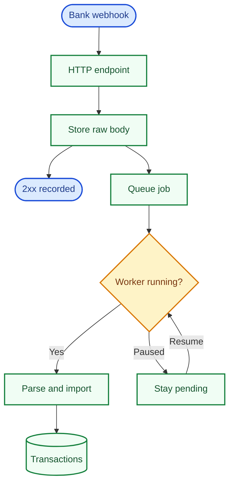

# Map 01 — Receive vs process

Status: Starter (refine after Milestone 1 / Lesson 003)  
Related: DI-02, FR-01, AMB-08  
Kind: flowchart

## What to show

Bank webhook hits HTTP → raw body stored → 2xx means **recorded** → worker parses/imports later → pause stops workers only.

## CHECK

Can you explain why pausing must not reject new webhooks?

## Source

- Challenge requirements: DI-02, FR-01  
- Laravel queues: https://laravel.com/docs/13.x/queues
